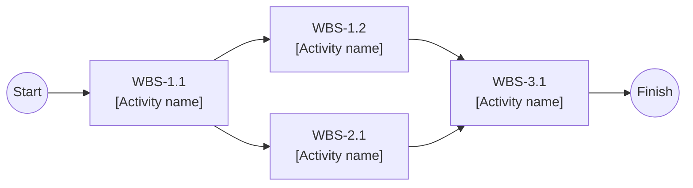
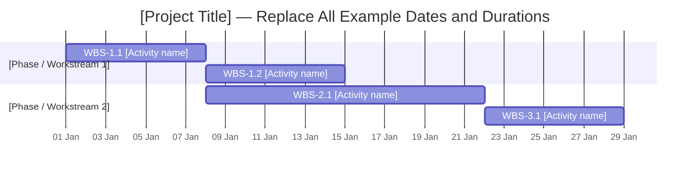

# Software Engineering — Project Plan

> **Template instructions:** Replace all text in `[square brackets]` with your project's information. Add or remove table rows as needed. Keep deliverable (`D-##`), task (`T-##`), work-breakdown (`WBS-#.#`), and risk (`R-##`) IDs consistent wherever they appear. Replace the illustrative PERT/Gantt diagrams with your actual project activities and dates before submission.

## Cover Page

| Field | Details |
|---|---|
| **Course** | [Course code and name] |
| **Report name** | Project Plan |
| **Project title** | [Project title] |
| **Group name / number** | [Group name or number] |
| **Group members** | [Name — Student ID], [Name — Student ID], ... |
| **Instructor** | [Instructor's name, if applicable] |
| **Submission date** | [YYYY-MM-DD] |
| **Document version** | [e.g., 1.0] |

---

## 1. Introduction

### 1.1 Scope

**Project overview:**  
[Briefly explain the problem, the intended users, and the solution your team will develop.]

**In scope:**
- [Feature, functionality, or activity included in this project]

**Optional scope:**
- [Feature, functionality, or activity may be included in this project]

**Out of scope:**
- [Feature, functionality, or activity explicitly excluded]

**Assumptions and constraints:**  
[Record important technology, time, budget, team, or course constraints.]

### 1.2 Deliverables

Number each project deliverable. Use the same IDs in the task table below. **Please note that, in this case, the deliverables are not the documents that you are going to submit throughout the project timeline. However, 'Documentation' is a deliverable itself ;)**

| Deliverable ID | Deliverable name | Description / contents | Acceptance criterion |
|---|---|---|---|
| D-01 | [Deliverable 1] | [What will be produced?] | [How will completion be checked?] |
| D-02 | [Deliverable 2] | [What will be produced?] | [How will completion be checked?] |
| D-03 | [Deliverable 3] | [What will be produced?] | [How will completion be checked?] |

### 1.3 Functional Requirements / Tasks

Number the functional tasks and map **every task** to one or more deliverables from Section 1.2.

| Task ID | Functional requirement / task | Description | Related deliverable ID(s) |
|---|---|---|---|
| T-01 | [Task 1] | [Expected behavior or function] | D-01 |
| T-02 | [Task 2] | [Expected behavior or function] | D-01, D-02 |
| T-03 | [Task 3] | [Expected behavior or function] | D-03 |

### 1.4 Non-functional Issues

Describe relevant quality attributes, including security, performance, and usability.

| Quality attribute | Requirement / concern | How it will be assessed |
|---|---|---|
| Security | [Access control, data protection, etc.] | [Test or assessment] |
| Performance | [Response time, throughput, etc.] | [Measurement or test] |
| Usability | [Accessibility, ease of use, etc.] | [Evaluation method] |
| Reliability | [Availability, error handling, etc., if relevant] | [Test or assessment] |
| Other | [Additional non-functional issue] | [Test or assessment] |

---

## 2. Project Plan — Work Breakdown Structure (WBS)

Decompose the tasks in Section 1.3 into smaller **subtasks / activities**. Give each WBS activity a unique ID, link it to its parent task, and estimate its size on this five-level scale:

**T = Tiny · S = Small · M = Medium · L = Large · XL = Extra-large**

| WBS activity ID | Parent task ID | Activity / subtask | Description / completion condition | Size (T/S/M/L/XL) |
|---|---|---|---|---|
| WBS-1.1 | T-01 | [Activity 1] | [Description and completion criterion] | [T/S/M/L/XL] |
| WBS-1.2 | T-01 | [Activity 2] | [Description and completion criterion] | [T/S/M/L/XL] |
| WBS-2.1 | T-02 | [Activity 3] | [Description and completion criterion] | [T/S/M/L/XL] |
| WBS-3.1 | T-03 | [Activity 4] | [Description and completion criterion] | [T/S/M/L/XL] |

**WBS decomposition notes:**  
[Explain how activities were divided, including important assumptions or dependencies.]

> **Course guideline note:** User stories for these subtasks will be written in the separate requirements document; this project plan defines and sizes the subtasks.

---

## 3. Estimates

Estimate effort for **each WBS activity** in **man-weeks (person-weeks)**. Keep the WBS IDs aligned with Section 2.

| WBS activity ID | Size | Estimated effort (man-weeks) | Basis / assumptions |
|---|---|---|---|
| WBS-1.1 | [T/S/M/L/XL] | [Number] | [Reason for estimate] |
| WBS-1.2 | [T/S/M/L/XL] | [Number] | [Reason for estimate] |
| WBS-2.1 | [T/S/M/L/XL] | [Number] | [Reason for estimate] |
| WBS-3.1 | [T/S/M/L/XL] | [Number] | [Reason for estimate] |
| **Total** | — | **[Sum of all estimates]** | — |

**Estimation method:**  
[Explain how your team converted WBS sizes and expected work into man-week estimates.]

**Effort versus duration:** If an activity requires **2 man-weeks** and **2 fully allocated team members** can work in parallel, its estimated duration is **1 week** (assuming no other constraints). Scheduling must account for actual availability and dependencies.

---

## 4. Resources

### 4.1 Team Structure and Member Roles

| Member | Student ID | Role(s) | Main responsibilities |
|---|---|---|---|
| [Member 1] | [ID] | [Role] | [Responsibilities] |
| [Member 2] | [ID] | [Role] | [Responsibilities] |
| [Member 3] | [ID] | [Role] | [Responsibilities] |

### 4.2 Member-to-Activity Assignment

Map group members to their assigned **WBS activities**. Use additional rows when an activity has multiple assigned members.

| WBS activity ID | Assigned member | Responsibility | Allocation to activity (FTE) |
|---|---|---|---|
| WBS-1.1 | [Member] | [Specific contribution] | [e.g., 1.0] |
| WBS-1.2 | [Member] | [Specific contribution] | [e.g., 0.5] |
| WBS-2.1 | [Member] | [Specific contribution] | [e.g., 1.0] |
| WBS-3.1 | [Member] | [Specific contribution] | [e.g., 1.0] |

**Availability or allocation constraints:**  
[State any part-time allocations, competing activities, holidays, or resource limits.]

---

## 5. Schedule

### 5.1 PERT Chart — Activity Sequence

Show the order and dependency relationships between project activities. **Replace this illustrative network** with your actual WBS activities, predecessors, and estimated durations. Highlight the critical path after calculating it.

**PERT notes (activity durations and dependencies):**  
[Explain the network, any parallel activities, and the basis of each duration.]

### 5.2 Critical Path and Total Project Duration

**Critical path (in activity order):**  
`[WBS-x.x] → [WBS-y.y] → [WBS-z.z]`

| Critical-path activity ID | Duration (weeks) | Reason it is critical |
|---|---|---|
| [WBS-x.x] | [Number] | [No available schedule slack / dependency explanation] |
| [WBS-y.y] | [Number] | [No available schedule slack / dependency explanation] |
| [WBS-z.z] | [Number] | [No available schedule slack / dependency explanation] |

**Total project schedule:** **[Number] weeks**, from **[YYYY-MM-DD]** to **[YYYY-MM-DD]**.

**Critical-path explanation:**  
[Explain how the critical path was identified from the PERT network and how it determines the overall project duration.]

### 5.3 Gantt Chart — Project Timeline

Update the example dates, activity names, and durations below using Section 5.1. The values shown here are **illustrative only and are not actual project dates**.

**Schedule consistency check:**  
[Verify that dates, durations, activity dependencies, effort estimates, and member availability agree across the WBS, estimates, resource map, PERT chart, and Gantt chart.]

---

## 6. Risks

### 6.1 Risk Impact / Probability Chart

Score both **probability** and **impact** on an ascending scale from **1 (lowest)** to **5 (highest)**. Place each risk ID in the corresponding matrix cell. Both axes increase from left to right / top to bottom.

**Risk register:** List risks in **ascending order of probability, then impact**. The optional score is `Probability × Impact`; retain the same scale and order throughout.

| Risk ID | Risk description | Probability (1–5) | Impact (1–5) | Risk score (P × I) | Affected WBS activity ID(s) |
|---|---|---|---|---|---|
| R-01 | [Risk description] | [1–5] | [1–5] | [Score] | [WBS-x.x] |
| R-02 | [Risk description] | [1–5] | [1–5] | [Score] | [WBS-y.y] |
| R-03 | [Risk description] | [1–5] | [1–5] | [Score] | [WBS-z.z] |

| Impact ↓ / Probability → | 1 (Very low) | 2 (Low) | 3 (Medium) | 4 (High) | 5 (Very high) |
|---|---|---|---|---|---|
| **1 — Very low** | [Risk IDs / —] | [—] | [—] | [—] | [—] |
| **2 — Low** | [—] | [—] | [—] | [—] | [—] |
| **3 — Medium** | [—] | [—] | [—] | [—] | [—] |
| **4 — High** | [—] | [—] | [—] | [—] | [—] |
| **5 — Very high** | [—] | [—] | [—] | [—] | [—] |

### 6.2 Risk Mitigation / Aversion Plan

Map **every identified risk** to relevant project activities and record preventive or mitigating actions.

| Risk ID | Related WBS activity ID(s) | Mitigation / avoidance strategy | Responsible member | Contingency if risk occurs |
|---|---|---|---|---|
| R-01 | [WBS-x.x] | [Actions to reduce probability or impact] | [Member] | [Fallback response] |
| R-02 | [WBS-y.y] | [Actions to reduce probability or impact] | [Member] | [Fallback response] |
| R-03 | [WBS-z.z] | [Actions to reduce probability or impact] | [Member] | [Fallback response] |
